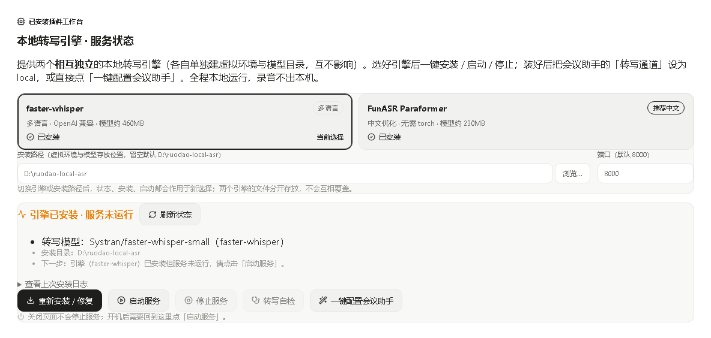

# 本地转写引擎（录音不出本机的 OpenAI 兼容 ASR）

> 会议、访谈、问诊、法务沟通——这些录音里全是不能外传的内容。可几乎所有"语音转文字"都要你把音频传到别人的服务器上。
>
> 若道本地转写引擎在你的电脑上装一个 **OpenAI 兼容的转写服务**（`POST /v1/audio/transcriptions`），会议助手等插件的「本地通道」直接连它。识别在本机跑，音频不出门。两个引擎可选：faster-whisper 多语言通用，FunASR Paraformer 中文更强且**不依赖 torch**——普通核显机器也能跑。

**📦 一键安装**：[https://ruodao.com/plugin-market/items/local-asr](https://ruodao.com/plugin-market/items/local-asr)（若道桌面端「功能插件市场」搜索"本地转写"，或市场页直接「下载 ZIP」用本地安装导入。）

---

## 💎 四个理由

### 🔒 1. 音频不出本机，这条是硬承诺

服务只监听 `127.0.0.1`，识别全程本地推理。没有云端账号也能用，不需要 API Key，不产生任何调用费用。

### 🀄 2. 中文选 FunASR，通用选 whisper

| 引擎 | 配置值 | 模型 | 体积 | 特点 |
| --- | --- | --- | --- | --- |
| faster-whisper（默认） | `whisper` | Systran/faster-whisper-small/base/medium | ≈140MB–1.5GB | 多语言通用，HuggingFace 下载 |
| **FunASR Paraformer** | `funasr` | iic/speech_paraformer-large…-onnx | ≈230MB | 中文开源最强之一，onnxruntime CPU 推理、**无 torch**，ModelScope 国内直连 |

两个引擎各有独立虚拟环境与模型目录，**互不影响、可共存**，随时切换。

### ⚡ 3. 无 GPU 也能跑，普通办公本够用

whisper 走 CPU + `int8` 量化；FunASR 走 `funasr-onnx`（int8 量化 Paraformer-large），不需要 CUDA、不需要独立显卡。装完即用。

### 🔗 4. 一键配好会议助手

不用手抄地址和模型名——点「一键配置会议助手」，插件自动探测麦克风与系统内录设备，把会议助手的转写通道、服务地址、模型名、录音时长一次填好，并确保服务已启动。

## 🖼️ 界面预览

| 引擎状态与安装 | 双引擎与安装目录 |
| --- | --- |
| [](docs/screenshots/1.png) | [](docs/screenshots/2.png) |

## ✨ 功能总览

| 命令 | 说明 |
| --- | --- |
| `status` | 引擎是否已装、服务是否在跑、双引擎各自状态、安装阶段与日志尾部 |
| `install` | 创建虚拟环境、装依赖、下载模型（幂等，首次约 10–20 分钟含模型下载） |
| `start` | 后台启动服务并等待健康检查通过（默认 `127.0.0.1:8000`） |
| `stop` | 停止服务 |
| `test` | 生成测试音频并转写，验证 `/v1/audio/transcriptions` 可用 |
| `apply-config` | 一键配置会议助手（探测设备 + 写入 local 通道 + 启动服务）；参数 `cloud` 可切回云端 |

## 📥 安装

1. 下载并安装 [若道桌面端](https://ruodao.com)。
2. 「功能插件市场」→ 搜索 **本地转写** → 安装。
3. 在配置里选引擎（`RUODAO_ASR_ENGINE`，默认 `whisper`）；中文会议建议 `funasr`。
4. 点「安装本地转写引擎」→ 完成后点「启动本地转写服务」→ 点「转写自检」验证。

## ⚙️ 配置

| 环境变量 | 默认 | 说明 |
| --- | --- | --- |
| `RUODAO_ASR_ENGINE` | `whisper` | 引擎选择：`whisper` / `funasr` |
| `RUODAO_ASR_PORT` | `8000` | 服务端口（两引擎共用） |
| `RUODAO_ASR_MODEL` | `small` | whisper 模型规格：`small` / `base` / `medium` |
| `RUODAO_ASR_HOME` | 用户目录下 `ruodao-local-asr` | 安装目录 |
| `RUODAO_ASR_PYTHON` | 自动探测 | 指定 Python 解释器（3.9–3.13） |

## 🚀 使用教程

### 给会议助手用

1. 装引擎 → 启动服务；
2. 点「一键配置会议助手」（或手动：会议助手设置里转写通道选 `local`，地址 `http://127.0.0.1:8000/v1`，模型 `whisper-1`）；
3. 会议助手里开始听写，识别全部在本机完成。

### 给别的程序用

任何支持 OpenAI 转写接口的客户端都能接：`base_url = http://127.0.0.1:8000/v1`，`model = whisper-1`（FunASR 对模型名不敏感）。

```bash
curl -s http://127.0.0.1:8000/v1/audio/transcriptions \
  -F file=@test.wav -F model=whisper-1
```

输入要求 16k 单声道 WAV（会议助手的录音链路已保证）。

## 🛠️ 二次开发

```
├── plugin.json           # 元信息
├── ruodao-plugin.json    # 核心：id、权限（process/network）、6 个命令
├── ui.json               # 工作台界面
├── bin/local-asr.mjs     # 安装/启动/停止/自检/配置业务逻辑
├── bin/funasr_server.py  # FunASR 服务端：标准库 HTTP + multipart，模型懒加载
└── docs/screenshots/     # 本页截图
```

FunASR 服务端是纯标准库实现（`http.server` + `email` 解析 multipart），模型懒加载：`/health` 立刻可用，首次转写约 10–30 秒加载。安装进度写在 `install.log` 与 `install-state.json`，被强制中断后可按 pid 判定，重新点击即可续装。

自检（无测试用例，直接跑状态与转写验证）：

```bash
node bin/local-asr.mjs status
node bin/local-asr.mjs test
```

## 📦 更新日志

- **v1.4.0**（当前开源版本）：FunASR Paraformer 引擎（onnx、无 torch）、双引擎共存、一键配置会议助手、转写自检。
- **v1.0.0**：faster-whisper 引擎与基础启停。

## 🔗 相关

- 插件市场页：[https://ruodao.com/plugin-market/items/local-asr](https://ruodao.com/plugin-market/items/local-asr)
- 搭配使用：[会议助手](https://github.com/ruodaoai/meeting-assistant)
- 若道官网：[https://ruodao.com](https://ruodao.com)
- 更多插件源码：[https://github.com/ruodaoai](https://github.com/ruodaoai)

## License

MIT
